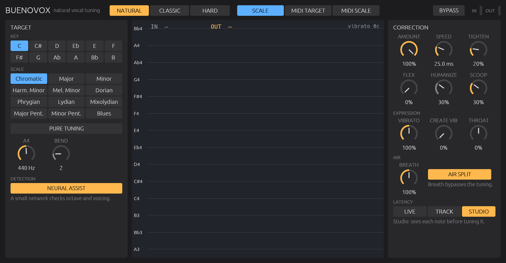

# BuenoVOX

**Natural vocal pitch correction (auto + MIDI), written in Rust with the
[truce](https://github.com/truce-audio/truce) framework.** AU, VST3 and CLAP for macOS
(Apple Silicon).

A research project for personal, non-commercial use and the study of the craft. The full plan
(state of the art, patents, roadmap) lives in [PLANO.md](PLANO.md) (Portuguese).



> Listeners are moved by the voice, not by the tuning. Getting the tuning right only removes
> the distraction.

BuenoVOX **corrects only the perceived center of each note and gives everything else back
untouched**: vibrato, attack, drift, micro-fluctuations, the singer's cycle-to-cycle jitter and
the air in the voice.

---

## Installation (release, Audio Unit, Apple Silicon)

1. Download `BuenoVOX-<version>-AU-macOS-arm64.zip` from
   [Releases](https://github.com/nagualcode/buenovox/releases) and unzip it.
2. Move `BuenoVOX.component` to `~/Library/Audio/Plug-Ins/Components/`.
3. The build is ad-hoc signed (no Apple developer certificate), so clear the quarantine flag:
   ```bash
   xattr -dr com.apple.quarantine ~/Library/Audio/Plug-Ins/Components/BuenoVOX.component
   ```
4. Restart your DAW (in Logic, the plugin manager rescans it; `auval -v aumf BVox JdSn` checks
   it from the terminal).

## Installation (from source)

```bash
cargo install cargo-truce                 # once
cargo truce install --au2 --vst3 --clap   # build, sign and install
```

Restart your DAW. In Live: *Plug-Ins → Audio Units → Jardim Sonoro → BuenoVOX*.

## Usage

1. Put **BuenoVOX** on the vocal track.
2. Pick a **style**:
   * **NATURAL** (default): moves each whole note to its target as a block. Vibrato, drift
     and attack stay the singer's own. Between legato notes the offset migrates in
     proportion to the singer's own glide.
   * **CLASSIC**: traditional correction, with *Speed* (2nd-order retune), *Flex* (only
     corrects near the note) and *Humanize* (longer notes are left looser).
   * **HARD**: instant retune, the effect. The note is chosen from the note's center, not
     from the instantaneous f0, so an out-of-tune singer with vibrato does not warble between
     two notes.
3. Pick the **target source**:
   * **SCALE**: key and scale (12 scales).
   * **MIDI TARGET**: each held MIDI note is the target. The DAW's piano roll becomes the
     graphical editor: notes are the targets and **pitch bend** draws the fine curve (range
     set by *Bend*). With no notes held, the key/scale applies. In Live, on a MIDI track,
     set *MIDI To* to the vocal track and then *BuenoVOX*.
   * **MIDI SCALE**: the notes you play define the allowed notes, latched until the next
     chord.

   The singer may anticipate or lag a MIDI note change by up to 60 ms.
4. **Correction:**
   * **Amount**: how much of the error to correct. 0% is transparent.
   * **Speed**: in Natural, smoothing of the note offset; in Classic, the retune time.
   * **Tighten** (Natural): how much to flatten slow drift inside a note.
   * **Scoop** (Natural): shortens scoops and falls at onsets after silence.
5. **Expression:**
   * **Vibrato**: 0–200% of the singer's vibrato.
   * **Create Vib**: adds vibrato to long straight notes, fading in slowly.
   * **Throat**: longer throat (darker voice) or shorter (brighter).
6. **Air:**
   * **Air Split** (on by default): the breath noise is separated from the voice before
     correction and passes around it at its original pitch. Only the harmonic part is retuned,
     so a breathy voice does not turn buzzy.
   * **Breath**: level of the separated air, 0–200% (100% = as sung).
7. **Detection:**
   * **Neural Assist** (on by default): a small network checks the pitch detector's octave and
     voicing decisions (see below).
8. **Tuning:**
   * **Pure Tuning**: just intonation relative to the lowest held MIDI note (or the tonic).
   * **A4**: reference from 415 to 466 Hz.
9. **Latency**, reported to the host (Live compensates on playback):
   * **STUDIO** (~270 ms): the brain sees ~190 ms ahead, almost the whole note, before
     correcting it. For mixing.
   * **TRACK** (~95 ms): for recording with monitoring.
   * **LIVE** (18 ms at any sample rate): for singing on stage. The audio does not wait for
     the pitch detector:
     * epoch marks are predicted from the real spacing of the previous cycle and confirmed by
       correlation, which needs only ~0.7 period of signal ahead;
     * grains are capped at 5 ms half-windows, so low voices get grains shorter than a period;
     * note decisions arrive ~30 ms after the sound, so the first ~30 ms of a note after
       silence pass uncorrected;
     * Hard divides by each cycle's real period, so its staircase stays sharp.

   A mode change takes effect when playback restarts or the plugin reloads.

---

## How it works

```
input ─► YIN (f0 every 4 ms) ─► epoch marks (one per glottal cycle)
                     │
                     ▼
               BRAIN (4 ms frames, with lookahead)
   segmentation by movement ─► local center (360 ms Hann, cancels vibrato)
   ─► note center (perceived pitch) ─► target (MIDI > scale) ─► policy
                     │ shift in semitones
                     ▼
   ratio PSOLA: synthesis period = real spacing between marks / ratio
```

* **Detector:** the YIN tracker inherited from [Heaven](https://github.com/nagualcode/heaven),
  with continuity-based candidates, octave tests, a register gate and a 3-frame median.
* **Neural assist:** a small convolutional network (4.8k parameters, ~0.7% of a core) looks at
  the same 32 ms of signal as YIN and arbitrates the cases where YIN fails: octave errors in
  vocal fry, belting with subharmonics, closed vowels with a strong 2nd harmonic, thin mics,
  reverb. Its inputs lie on a log-pitch axis (2 positions per semitone, 62–1080 Hz): YIN's
  periodicity `1 − CMND(sr/f)`, the spectrum read at f/2, f, 2f, 3f, 4f and 5f, and the level.
  Everything is in Hz and seconds, so the network does not depend on the sample rate. When it is
  confident of another pitch, the CMND valley near it wins (precision stays YIN's). It also
  vetoes voicing that YIN finds only weakly periodic. It never declares voice on its own (that
  raised false voicing on real singing). Trained in PyTorch (`train/`) on synthetic source-filter
  voices with known f0 (`src/dsp/voicegen.rs`) plus 2.6 h of
  [VocalSet](https://zenodo.org/records/1442513) (fry, breathy, belt, lip trill, vibrato...)
  labelled by CREPE as a teacher, from 18 singers (two more held out for testing); inference hand-written in Rust with the weights
  embedded, no allocations; a test checks it against PyTorch (largest probability difference
  2·10⁻⁶).
* **Segmentation by movement, not by rounding.** In a pitch corrector the singer is off center
  by definition, and with vibrato the peaks would cross the semitone boundary every cycle. A
  new note starts:
  * after silence;
  * on a leap (the voice is about to land far from the anchor);
  * or on a small step, detected by a *short center*: a 180 ms average, about one vibrato
    cycle, that cancels the vibrato and rises exactly at the step. So a legato half step with
    vibrato is still detected.
* **Perceived pitch:** the average of the local center over stable frames, with the attack
  (scoop, overshoot) weighted down. This is the *stationary pitch* of BERT-APC.
* **Natural:** `y = p + amount·(T − C) − tighten·drift + (vibrato − 1)·vib + created vibrato`.
  With the defaults this is a uniform shift of the whole note.
* **Ratio PSOLA:** grains are re-placed at the real spacing between analysis marks divided by
  the correction ratio. The singer's natural jitter reaches the output, and without correction
  the synthesis marks stay locked to the analysis marks: the output is the input itself, cycle
  by cycle. Each grain's half-windows are the real distances to the neighboring marks, so they
  sum to exactly 1 even when the period changes (vibrato).
* **Breath separation:** PSOLA treats each cycle as if it were all periodic. In a breathy voice
  the air noise is cut into grains and repeated at the new period: it takes on the pitch of the
  corrected note and turns into a metallic buzz. BuenoVOX separates it first:
  * the **harmonic part** is the average of neighboring cycles, aligned on the epoch marks (each
    cycle is the vocal tract's response to one glottal pulse, so the neighbor is read at the same
    distance from its own mark, without time-stretching). What repeats cycle after cycle stays;
    the noise, which does not repeat, falls with the number of cycles;
  * each neighbor is re-aligned to the current cycle by fractional broadband correlation and
    scaled by the energy ratio, because noise shifts the marks by fractions of a sample and notes
    change level at the attack and release;
  * the **air** is `voice − harmonic` above 1 kHz, through a linear-phase FIR (below 1 kHz the
    residual is mostly model error, which would sound like a ghost of the old note);
  * the corrected path reads `voice − air`, so without correction the two parts add back to the
    voice sample for sample. Averaging span: ±35 ms in Studio, −35/+10 ms in Track, past-only
    30 ms in Live.

## The ruler

Whoever writes the DSP cannot listen, so everything is measured against a **synthetic singer
with known f0** (`src/dsp/testsig.rs`). It is an additive source-filter synthesis with the
formants of the vowel "a" and a Saitou-model contour:
* 2nd-order overshoot at transitions;
* onset scoop;
* vibrato with delay and growth;
* fine fluctuation.

Each note can be sung out of tune, so the right answer is known.

```bash
cargo test --profile regua --no-default-features -- --nocapture
```

Current figures, on a 7-note phrase with the singer off by up to ±35 cents, 40-cent vibrato,
legato, a legato half step and rests:

| | Note-center error | Shift variation within the note* |
|---|---|---|
| Natural / Studio | ≤ 2.1 cents | ≤ 1.5 cents |
| Natural / Track | ≤ 4.0 cents | ≤ 3.6 cents |
| Natural / Live (18 ms) | ≤ 3.7 cents | ≤ 4.9 cents |
| Classic (120 ms retune) | ≤ 2.9 cents | ≤ 6.8 cents |
| Hard (Studio and Live) | ≤ 2.0 cents | output held still: ≤ 0.3 cent deviation |

\* 0 = vibrato, drift and fine fluctuation passed through untouched.

Other figures:
* **Detector:** **0.27 cent** median error, 0% gross errors.
* **Neural assist on real singing** ([vocadito](https://zenodo.org/records/5578807), 40 solo
  excerpts with human f0 annotation, never used in training), frame by frame:

  | | Pitch within 50 cents | Gross errors | Octave errors | Voice found | False voice |
  |---|---|---|---|---|---|
  | YIN alone | 94.3% | 3.23% | 1.03% | 97.5% | 21.1% |
  | YIN + network | **95.1%** | **2.63%** | **0.39%** | **97.7%** | **18.9%** |

  On held-out synthetic hard voices (fry, belt, breathy, thin mic, reverb, noise): gross errors
  13.4% → 5.2%, octave errors 10.1% → 2.4%, voice found 91.2% → 91.8%. On two held-out VocalSet
  singers, against CREPE labels: octave errors 1.10% → 0.50% overall, vocal fry 3.8% → 1.5%,
  belt 0.6% → 0%.
* **PSOLA with no correction:** **87 dB** SNR against the dry signal in Studio and **98 dB** in
  Live, with breath separation on (the waveform, not just the timbre).
* **Breath separation**, on a very breathy synthetic voice (harmonic-to-noise ratio 6 dB, 40-cent
  vibrato), each true component separated on its own with the mixture's recipe:

  | | Harmonic leaking into the air path ("ghost") | Air left in the corrected path (> 2 kHz) |
  |---|---|---|
  | Studio | −24 dB | −13 dB |
  | Track | −24 dB | −12 dB |
  | Live | −24 dB | −10 dB |

  Breathy voice shifted up 4 semitones by MIDI: the high-band harmonic-to-noise ratio measured on
  the output is 7.8 dB without separation (the air became periodic) and 6.0 dB with it, against
  5.6 dB on the input. **Breath** at 0% removes 12 dB of air; at 200% adds 5.6 dB.
* **Live with large host buffers:** after a rest, the first marks of a note arrive after the grain
  plan has passed the onset; a bridging grain re-locks the plan to the marks (before this fix,
  with 512- or 1024-sample buffers the rest of the note came out up to 5 ms shifted).
* **Low voice in Live** (A2, 110 Hz, capped grains): corrected within 8 cents, energy within
  1.2 dB.
* **Bypass:** identical to the delayed dry signal.
* **Block size:** output is unchanged between 64 and 1024 samples.
* **MIDI Target:** 60 → 59.998 and 62 → 61.999.
* **Pitch bend:** +0.5 st → 60.499.
* **Robustness:** no data starvation at 44.1, 48 or 96 kHz in any mode; survives silence, noise,
  impulses, clipping and NaN.
* **Performance:** in Studio with breath separation, ~53× real time at 48 kHz and ~31× at 96
  kHz; Live ~82× at 48 kHz. Neural assist adds ~7 ms per second of audio (Studio 42×, Live 52×
  at 48 kHz with everything on).
* **Validators:** passes **auval** (AU v2 and v3) and **pluginval** (VST3).

## Development

```bash
cargo test --profile regua --no-default-features            # the ruler
cargo build --release --no-default-features --bin bvx_cli
target/release/bvx_cli gen phrase.wav detune=35 vibrato=40  # synthetic singer
target/release/bvx_cli vocal.wav out.wav key=C scale=major style=natural dump=curves.csv
target/release/bvx_cli vocal.wav out.wav source=miditarget midi="0-2:60;2-4:62"
cargo truce screenshot --out docs/gui.png
```

Neural detector (Python only for training; the plugin has no Python or ONNX dependency):

```bash
target/release/bvx_cli dataset train/data/synth/s1.bin seed=1 files=34 stride=3   # synthetic frames
python train/teacher.py train/data/teacher <VocalSet wavs>   # CREPE labels (or train/teacher_all.sh)
cd train && python train.py runs/net.bin --vocalset --epochs 4   # train, validate on vocadito
./eval_fused.sh runs/net.bin                            # YIN+network vs annotations
python check.py runs/net.bin.pt ../models/pitchnet_check.bin   # PyTorch reference for the Rust test
```

`bvx_cli` runs the plugin's own engine offline. With `dump=` it writes, every 4 ms frame, the
input pitch, target, output, shift, vibrato, note center, local center and anchor.

License: MIT or Apache-2.0.
